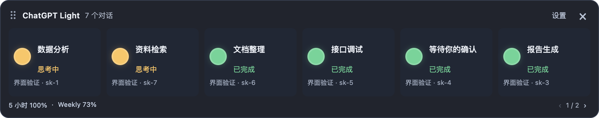
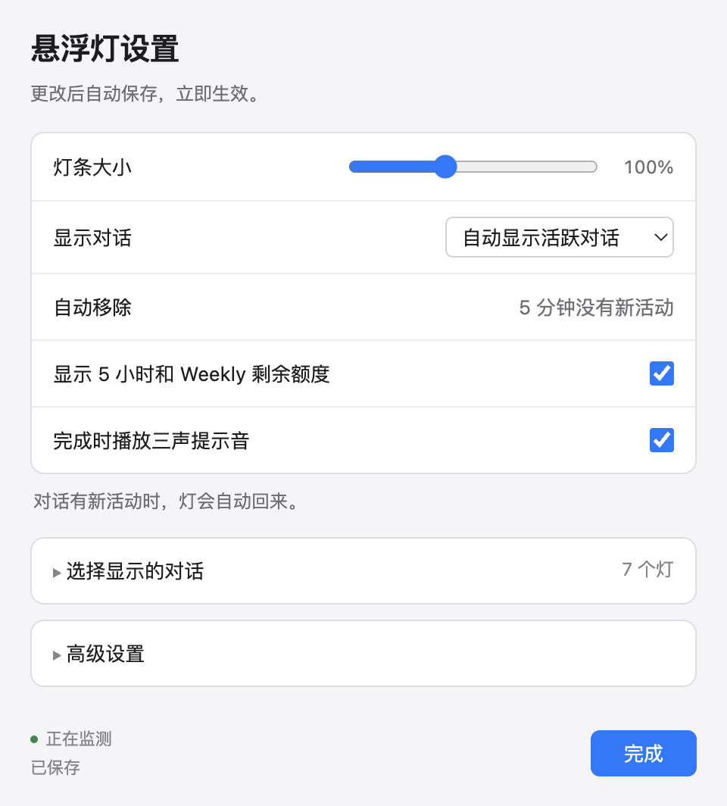

# ChatGPT Light

ChatGPT Light 是一个 macOS 悬浮状态灯工具，用于查看 ChatGPT 桌面应用中产生本地 Codex 会话日志的对话状态。每个对话对应一盏灯，便于同时关注多个任务，在任务完成时收到声音提示。

当前版本：`0.0.1`。

## 界面预览



<details>
<summary>查看设置界面</summary>



</details>

预览使用示例对话，截图中的额度数值为演示数据。

## 主要功能

- 每个对话独立显示状态、标题和项目名称。
- 按最近一次用户提问的时间排序，新提问的对话排在前面。
- 自动显示最近活跃的对话，也可以手动选择或隐藏对话。
- 对话超过 5 分钟没有新活动时移出灯条；有新活动时，自动模式会重新显示。
- 任务完成时播放三声提示音，多个对话完成时可以重叠播放。
- 默认显示 5 小时和 Weekly 的剩余额度，并根据账户类型处理显示规则。
- 支持拖动灯条、调整大小和翻页，设置修改后自动保存。

## 安装和开始使用

使用打包后的应用时，无需安装 Node.js 或 npm。电脑上需要有已登录的 ChatGPT 或 Codex 桌面应用，以及可供读取的本地 Codex 会话日志。账户额度读取还需要桌面应用附带的 Codex CLI 和可用的网络连接。

1. 选择适合自己芯片的 `.dmg` 安装包。
2. 双击 `.dmg`，把里面的 `ChatGPT Light.app` 拖到“应用程序”文件夹。
3. 从“应用程序”打开 ChatGPT Light。
4. 在 ChatGPT 或 Codex 中开始一个使用本地会话日志的任务，灯条会自动显示对应的对话。

应用启动后显示悬浮灯条。点击灯条上的“设置”，或右键选择“设置”，可以打开设置窗口。

### 灯的含义

| 灯的状态 | 含义 |
| --- | --- |
| 橙色 | 正在思考 |
| 红色 | 正在执行工具或输出回复 |
| 红色闪烁 | 等待确认、授权或回复 |
| 红色，并显示“错误/阻塞” | 收到错误事件 |
| 绿色 | 收到明确的任务完成事件 |
| 灰色，并显示“已停止” | 本轮已中断 |
| 灰色，并显示“待确认状态” | 暂时无法确认状态 |
| 灰色，并显示“离线” | 灯条与本地状态服务断开连接 |

状态来自可识别的本地日志事件。执行或思考状态超过 2 分钟没有更新时，应用显示“待确认状态”，需要后续事件确认实际进展。

### 设置与操作

| 设置或操作 | 使用方式 |
| --- | --- |
| 调整大小 | 在设置中拖动“灯条大小”滑块，范围为 40%–200%；也可以按住 `⌘` 或 `Ctrl` 滚动鼠标 |
| 移动灯条 | 拖动顶部拖动区域或对话卡片 |
| 显示对话 | 选择“自动显示活跃对话”或“仅显示我选择的对话” |
| 选择对话 | 展开“选择显示的对话”，搜索并勾选需要显示的对话；取消勾选可以隐藏 |
| 翻页 | 对话数量超出窗口容量时，使用底部的左右箭头 |
| 显示额度 | 开启或关闭“显示 5 小时和 Weekly 剩余额度”，默认开启 |
| 完成提示音 | 开启或关闭“完成时播放三声提示音”，默认开启 |
| 关闭设置 | 点击“完成”，灯条继续运行 |
| 退出应用 | 点击灯条右上角的 `×`，或右键选择“退出应用” |

手动选择的对话同样遵循 5 分钟无活动移除规则。选择记录会保留，对话有新活动时仍可重新显示。

### 完成提示音

灯条监控的对话从其他状态变为“已完成”时，播放三声“叮”。当前节奏约为每 0.95 秒响一声，整段约 2.9 秒。

多个对话的提示音独立播放，可以重叠。翻页不会阻止其他页上的对话触发提示音。启动、刷新或重新连接时，已经完成的对话不会补播提示音。

关闭提示音开关后，正在播放的铃声也会停止。重新开启后，从下一次新的完成事件开始播放。

### 剩余额度

额度百分比表示**剩余可用额度**。`Weekly` 表示账户返回的周额度窗口。

| 账户类型 | 5 小时 | Weekly |
| --- | --- | --- |
| Pro | 按当前显示规则固定显示 `100%`，表示没有 5 小时限额 | 显示账户返回的实际剩余额度 |
| Plus | 显示实际剩余额度 | 显示实际剩余额度 |
| 未识别或数据缺失 | 显示 `--` | 显示 `--` |

应用按额度窗口时长区分 5 小时与 Weekly，支持账户仅返回 Weekly 的情况。鼠标停在额度上可以查看账户类型和可用的重置时间。

账户客户端启动时读取一次额度，之后约每 30 秒读取一次，也会处理官方接口发来的额度更新通知。账户数据优先；尚未读取到账户数据时，会尝试使用日志中的额度记录。

Pro 的显示规则依据当前 [OpenAI 官方额度说明](https://learn.chatgpt.com/docs/pricing#what-are-the-usage-limits-for-my-plan)。实际账户额度以官方返回的数据为准，后续规则变化时需要同步调整应用。

## 从源代码运行

需要 macOS、Node.js 22 或更新版本，以及 npm。在项目目录执行：

```bash
npm ci
npm start
```

`npm start` 会启动桌面应用及本地状态服务。

## 打包 macOS 应用

### 双击打包

1. 在 Finder 中打开项目文件夹。
2. 双击根目录的 [`build-macos.command`](build-macos.command)。
3. 直接按回车，打包适合当前 Mac 的版本；或者输入菜单中的编号，选择 ARM、Intel 或通用版。
4. 等待出现“打包完成”，结果文件夹会自动打开。

打包需要 Node.js 22 或更新版本、npm 和 Xcode Command Line Tools。脚本在缺少项目依赖时会自动运行 `npm ci`；首次安装依赖或下载其他架构的 Electron 时需要网络连接。

如果缺少 Xcode 命令行工具，可在终端运行：

```bash
xcode-select --install
```

### 命令行打包

在项目目录执行以下命令中的一条：

```bash
# 当前 Mac 的架构
npm run build:mac

# Apple Silicon / M 系列芯片
npm run build:mac -- arm64

# Intel 芯片
npm run build:mac -- x64

# 一个应用同时支持 ARM 和 Intel
npm run build:mac -- universal

# 分别生成 ARM 和 Intel 两个版本
npm run build:mac -- all

# 只生成 .app
npm run build:mac -- arm64 --app-only
```

底层脚本是 [`scripts/build-macos.sh`](scripts/build-macos.sh)，可以使用 `--help` 查看用法。脚本输出到 `dist/release/<架构>/`，默认生成应用和 DMG，并检查应用主程序的芯片架构。

ARM 版产物示例：

```text
dist/release/arm64/
├── mac-arm64/
│   └── ChatGPT Light.app
└── ChatGPT-Light-V0.0.1-arm64.dmg
```

| 架构 | 适用设备 |
| --- | --- |
| `arm64` | Apple Silicon / M 系列 Mac |
| `x64` | Intel Mac |
| `universal` | 同时支持两种芯片，安装包体积更大 |

### `.app` 和 `.dmg` 的区别

- `.app` 是应用本体，安装后真正运行的是它。
- `.dmg` 是磁盘镜像，用于把应用打包成便于下载和分发的文件。

安装时打开 `.dmg`，将 `.app` 拖入“应用程序”，然后从“应用程序”启动。复制完成后可以弹出磁盘镜像。芯片兼容性由里面的 `.app` 决定。参见 [electron-builder 的 DMG 说明](https://www.electron.build/v26/docs/dmg/)。

### 更新已有安装

1. 完全退出正在运行的 ChatGPT Light。
2. 用新打包的 `.app` 替换旧应用。
3. 重新打开应用。

重新打包生成的是新文件。要让设置界面、铃声或其他功能的代码修改生效，需要运行更新后的应用。

## 常见问题

### 灯条没有显示对话

先在 ChatGPT 或 Codex 中开始一个本地任务，并检查以下设置：

- “显示对话”是否处于自动模式，或手动模式中是否已勾选对应对话。
- 对话是否已超过 5 分钟没有新活动。
- “高级设置”中的本地对话日志目录是否正确，默认是 `~/.codex/sessions`。

应用最多监控最近更新的 100 个会话日志。普通网页聊天，以及没有生成这些本地日志的对话，不在当前监控范围内。

### 额度显示 `--`

确认桌面应用已经登录账户，并检查“高级设置”中的 ChatGPT 应用路径。应用默认会查找 `/Applications` 和用户“应用程序”目录下的 `ChatGPT.app` 或 `Codex.app`。

额度读取依赖桌面应用附带的 Codex CLI。如果找不到 CLI、账户连接失败，或者返回的数据中没有对应窗口，应用会显示未知值。鼠标停在额度显示上可以查看可用信息。

### 为什么没有声音

检查“完成时播放三声提示音”是否开启，以及 Mac 的系统音量和输出设备。只有灯条监控的对话出现新的完成状态时才会响；已经是绿色的对话不会反复播放。

### 哪些窗口可以关掉

设置窗口、打包结果的 Finder 窗口，以及已完成打包的终端窗口都可以关闭。点击灯条右上角的 `×` 会退出整个应用，停止监控和声音提示。

### 重复打开应用

应用采用单实例方式运行。再次打开会显示已运行的灯条。更新版本时，请先完全退出旧应用，再启动新应用。

## 开发与验证

```bash
# 自动化测试
npm test

# 使用独立示例数据验证桌面窗口、设置、铃声和额度
npm run smoke -- --fixtures

# 单独启动本地服务，用于开发调试
npm run server
```

桌面验证会短暂打开测试窗口，并将预览截图写入 `dist/`。示例模式使用临时数据目录，不会修改真实 Codex 会话日志。

本地服务默认监听 `http://127.0.0.1:19001`。单独调试服务时，应先退出使用同一端口的桌面应用。

### 项目结构

| 文件 | 职责 |
| --- | --- |
| `main.js` | Electron 窗口、单实例运行和应用生命周期 |
| `server.js` | 本地 HTTP / WebSocket 服务、设置和状态汇总 |
| `session-monitor.js` | 日志发现、增量读取和会话状态恢复 |
| `session-state.js` | 日志事件与状态的对应关系 |
| `account-quota.js` | 官方 app-server 客户端及账户、额度读取 |
| `widget-layout.js` | 灯条窗口尺寸和位置 |
| `public/widget-model.js` | 对话排序、选择和过期移除 |
| `public/quota-model.js` | 账户类型和额度窗口的显示规则 |
| `public/completion-sound.js` | 完成事件检测和三声提示音 |
| `public/` | 灯条与设置界面 |
| `build-macos.command` | 双击打包入口 |
| `scripts/build-macos.sh` | macOS 打包脚本 |
| `tests/` | 自动化测试 |

### 本地配置

设置默认保存到 `~/.traffic-light-service-config.json`，窗口位置保存到 Electron 应用数据目录下的 `traffic-light-config.json`。

开发时可以使用以下环境变量：

| 环境变量 | 用途 |
| --- | --- |
| `CODEX_LIGHT_PORT` | 指定本地服务端口，默认 `19001` |
| `CODEX_LIGHT_CONFIG_FILE` | 指定设置文件位置 |
| `CODEX_LIGHT_DATA_DIR` | 指定默认 Codex 数据根目录及会话元数据来源 |
| `CODEX_HOME` | 未设置 `CODEX_LIGHT_DATA_DIR` 时，作为默认 Codex 数据根目录 |

已经保存的日志目录设置会覆盖默认日志路径。调整数据根目录时，也应检查设置界面中的日志目录。

## 实现与代码来源

项目从 Codex light 的早期代码基础演进，部分本地服务和启动控制逻辑保留了原有实现。当前的对话灯条、状态处理、设置界面、提示音、日志监听模块及账户读取客户端已进行重新设计或编写。

账户额度读取使用 [OpenAI 官方 Codex app-server 协议](https://developers.openai.com/codex/app-server)，通过 `account/read` 和 `account/rateLimits/read` 获取账户类型及额度。OpenAI 提供接口；本项目实现调用这些接口的客户端。当前项目没有安装 OpenAI SDK。

应用基于 Electron、Express 和 ws。会话日志在本机读取，状态通过本地服务传给窗口；账户额度查询需要由 Codex 连接 OpenAI 服务。

## 许可证

本项目使用 [MIT License](LICENSE)。Electron 及其他第三方依赖保留各自的许可证；打包配置会一并包含 Electron 的许可证文件。
